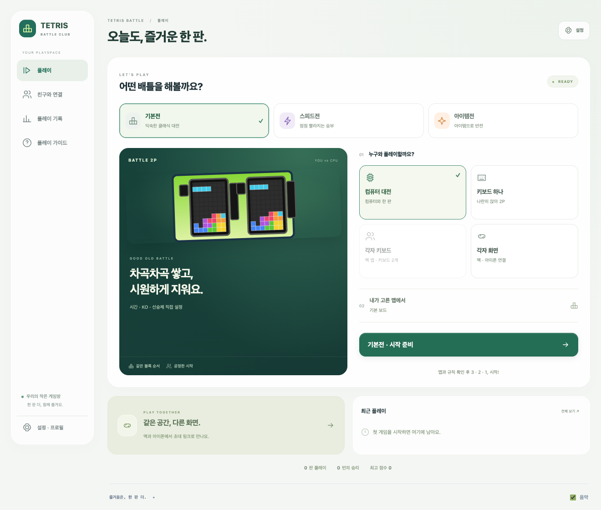

# Tetris Battle Classic

맥에서 두 사람이 함께 즐기는 테트리스 배틀입니다. **Battle Club** 화면에서 기본전·스피드전·아이템전과 플레이 방식을 고른 뒤, 시작 설정과 3·2·1 카운트다운을 거쳐 플레이합니다.



## 주요 기능

- CPU 대전, 한 키보드 2P, 맥에서 키보드 두 개를 사용하는 2P
- 같은 Wi-Fi의 맥·아이폰에서 방 코드와 링크로 연결하는 대전
- 2P는 매 판 직전과 다른 랜덤 맵, 두 플레이어에게 같은 블록 순서
- 숫자키로 쓰는 수집형 아이템과 선택 가능한 자동 부스트
- 시간·KO·선승제·협동·실력 보정 설정
- 개인 프로필, 키 배치·반응 속도 저장, 키보드 자동 배정
- 결과 비교, 두 사람 준비 후 재대결, 경기 내 명장면 다시 보기
- 모바일 하단 메뉴와 고정 시작 버튼, 터치 컨트롤러

## 맥 앱 빌드

필요한 도구: Node.js 20 이상, npm, `go.mod`에 지정된 Go, Xcode Command Line Tools. 맥 앱은 Apple Silicon/macOS 12 이상을 대상으로 합니다.

```sh
npm --prefix client-nuxt ci
bash macos/build.sh
open 'dist/Tetris Battle.app'
```

결과물은 `dist/Tetris Battle.app`, `dist/Tetris Battle.zip`입니다. 앱이 자체 Go 서버를 시작하고 종료 시 정리합니다. 기본 포트 8080이 비어 있어야 합니다. 사용 가능한 Apple Development 서명 또는 로컬 임시 서명을 사용하며, 일반 배포용 Developer ID 공증은 포함하지 않습니다. 자세한 내용은 [맥 실행 안내](macos/README.md)를 참고하세요.

## 브라우저 개발

```sh
npm --prefix client-nuxt ci
npm --prefix client-nuxt run dev
```

전체 로컬 대전 서버를 실행하려면 먼저 정적 파일을 생성합니다.

```sh
TETRIS_DESKTOP=1 npm --prefix client-nuxt run generate
mkdir -p public
cp -R client-nuxt/.output/public/. public/
go run ./cmd/macos
```

실제 접속 주소·실행 옵션은 [맥 실행 안내](macos/README.md)에 있습니다. 외부 인터넷 대전에는 별도의 서버 또는 연결 경로가 필요합니다. 이 저장소에 올리는 것만으로 인터넷 서버가 배포되지는 않습니다. Firebase는 기존 레거시 기능의 선택 사항이며 로컬 게임에는 필요하지 않습니다.

## 조작

| 입력 | 1P / 등록된 각자 키보드 | 한 키보드 2P |
|---|---|---|
| 이동 | ← → | A D |
| 회전 / 내리기 | ↑ / ↓ | W / S |
| 빠른 낙하 / 홀드 | Space / C | Q / E |
| 수집형 아이템 | 1·2·3 또는 V·B·N | 7·8·9 또는 R·T·Y |
| 결과에서 재대결 준비 | Enter | Shift+Enter |

키보드 두 개는 macOS 입력 모니터링 허용과 첫 등록이 필요합니다. 같은 기기임을 명확하게 식별할 수 있을 때 자동 복원하며, 모호하면 다시 등록합니다. CPU·온라인·각자 키보드의 키 배치와 입력 속도는 설정 → 프로필에서 바꿀 수 있습니다.

## 검증

```sh
npm --prefix client-nuxt run typecheck
npm --prefix client-nuxt test
go test -race ./...
```

Go의 정적 파일 포함을 위해 먼저 위의 정적 파일 생성·복사 과정을 실행하세요. `macos/verify-*.mjs`는 개발 과정의 브라우저 검증 도구이며 일부는 로컬 Codex Playwright 경로를 사용합니다.

## 출처

기존 [oatrice/Tetris-Battle](https://github.com/oatrice/Tetris-Battle)의 코드와 히스토리를 바탕으로 확장했습니다. 원본 프로젝트 안내는 [UPSTREAM-README](docs/UPSTREAM-README.md)에 보존했습니다. 원작 스타일 화면·스프라이트·음악과 맵 참고 자료는 [HCN1222/Tetris-battle-with-Q-learning](https://github.com/HCN1222/Tetris-battle-with-Q-learning)이며, 해당 MIT 고지를 [REFERENCE-LICENSE](macos/REFERENCE-LICENSE)에 보존했습니다.

원작 공개 자료를 참고한 개인용 재구현입니다. 공식 Facebook/Tetris 서비스가 아니며, 속도전·수집형 아이템 등은 확장 규칙입니다. CPU는 로컬 휴리스틱으로 동작합니다. 프로젝트 라이선스는 [MIT](LICENSE)입니다.
